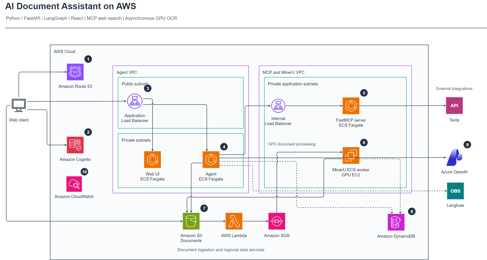

# AI Document Assistant on AWS

An AI document assistant built with **Python, FastAPI, LangGraph, and React**. It supports PDF uploads, asynchronous OCR, document summaries, conversational question answering, and web search. The frontend and backend run on Amazon ECS Fargate, while a MinerU ECS worker processes documents on GPU-enabled EC2.

## Features

- **Document processing:** Upload PDFs directly from the browser to Amazon S3. Lambda and SQS coordinate asynchronous MinerU OCR.
- **Document question answering:** Retrieve authorized OCR output and use Azure OpenAI to generate summaries and answers, streamed through Server-Sent Events (SSE).
- **Tool integration:** Reuse MCP connections to call FastMCP tools, including Tavily web search.
- **Conversation isolation:** Scope document search and retrieval to the authenticated user and conversation, with expiry and deletion-state checks.
- **User controls:** Display upload and OCR/tool activity, stop response generation, delete documents, and submit answer feedback.
- **Observability:** Record operational events in CloudWatch and correlate model/tool traces and user feedback in Langfuse.

## Cloud Architecture

### Numbered Components

1. **Amazon Route 53 — DNS resolution**  
   Resolves the application domain to the public Application Load Balancer (ALB). After DNS resolution, the browser connects directly to the ALB; Route 53 does not proxy HTTP requests.

2. **Amazon Cognito — Authentication**  
   Handles sign-in and token issuance. The frontend includes authentication tokens in API requests, and FastAPI verifies identity and resource access.

3. **Application Load Balancer — Application entry point**  
   Receives HTTPS traffic and routes requests to the Web UI or Agent backend according to the request path. The React Web UI is served by Nginx on ECS Fargate.

4. **Agent — Python, FastAPI, and LangGraph**  
   FastAPI exposes chat, upload, execution-control, and document APIs. LangGraph coordinates model and tool execution. The backend manages conversation history, waits for OCR, retrieves authorized document content, and streams answers to the browser. It runs on ECS Fargate.

5. **FastMCP — Web search tools**  
   The Agent connects through an internal ALB to a FastMCP server on ECS Fargate, which calls Tavily when web search is needed. Each reusable MCP worker owns its connection, session, and Agent, reducing repeated initialization.

6. **MinerU ECS worker — GPU OCR**  
   Runs on GPU-enabled EC2 and polls SQS for jobs. The parent process owns job claims, cancellation monitoring, and S3 transfers, while a reusable OCR child process handles parsing. OCR output is stored in S3, and job status is updated in DynamoDB.

7. **Amazon S3 — Document storage and ingestion**  
   The browser uploads documents using a presigned POST issued by the backend. An S3 upload event invokes Lambda, which validates job metadata and sends work to SQS for the MinerU worker. S3 stores both original documents and OCR output.

8. **Amazon DynamoDB — Conversation and job state**  
   Stores conversation records, request execution state, OCR jobs, and document-deletion control records. Retrieval checks the owner, conversation, expiry, and document lifecycle. DynamoDB is a regional service outside the private subnets shown in the diagram.

9. **Azure OpenAI — Answer generation**  
   Generates summaries and answers using conversation messages, bounded document context, and tool results supplied by the Agent. OCR processing and answer generation are separate stages.

10. **Amazon CloudWatch — Operational monitoring**  
    Collects application and worker logs, request outcomes, latency measurements, and MCP pool monitoring events. Langfuse, shown separately, supports model/tool trace analysis and user feedback.

**Connection legend:** Solid lines show primary request or document-processing flows. Dashed lines show state persistence or tracing relationships; they do not inherently mean asynchronous or optional behavior. Numbers identify components rather than a mandatory execution sequence.

## Test Videos

The following recordings demonstrate the assistant with two PDF test documents. Open the video links to play or download the MP4 files; inline playback depends on GitHub and browser support.

### Test 1: AWS Intelligent Document Processing Architecture

- **Document:** `accelerated-intelligent-document-processing-on-aws.pdf`
- **Scenario:** Test the assistant using an AWS intelligent document processing architecture PDF.
- **Recording:** [Watch Test 1](resources/test1.mp4)
- **Source PDF:** [Open the test document](resources/accelerated-intelligent-document-processing-on-aws.pdf)

### Test 2: EPA Sample Letter

- **Document:** `epa_sample_letter_sent_to_commissioners_dated_february_29_2015.pdf`
- **Scenario:** Test the assistant using the EPA sample letter PDF.
- **Recording:** [Watch Test 2](resources/test2.mp4)
- **Source PDF:** [Open the test document](resources/epa_sample_letter_sent_to_commissioners_dated_february_29_2015.pdf)

These recordings are demonstrations, not automated tests or a comprehensive correctness evaluation.